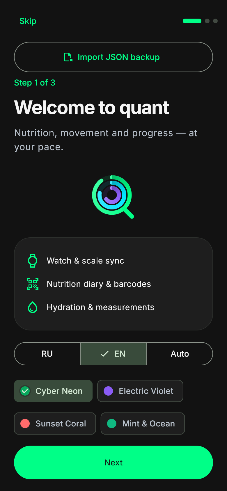
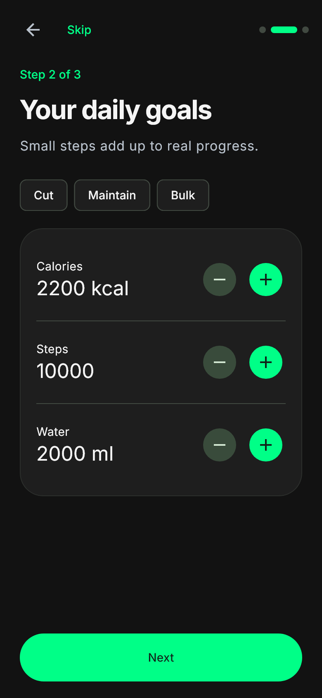
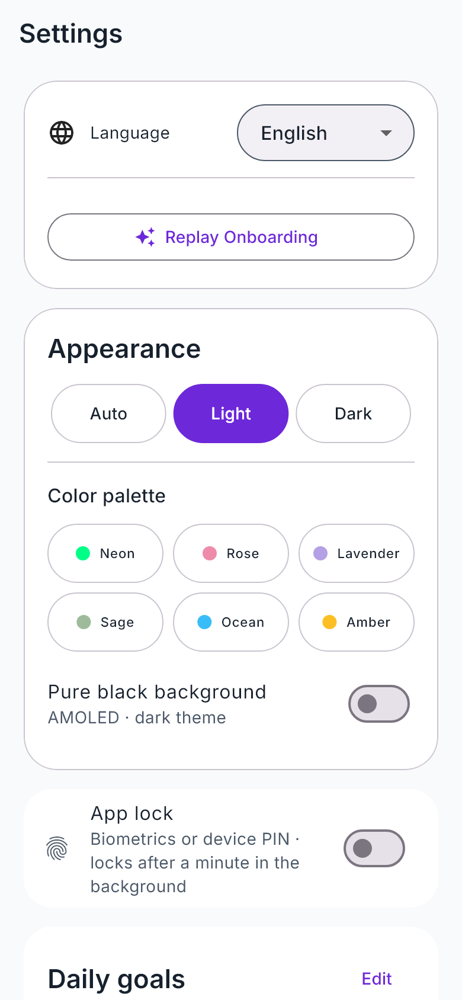
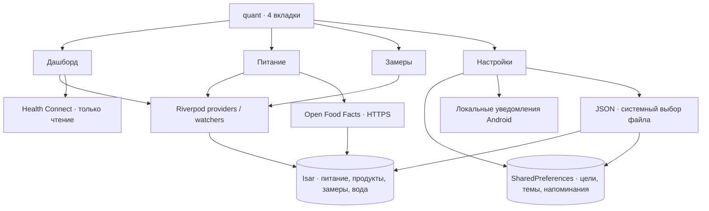

# quant


Android-приложение для питания, воды, активности и замеров. Flutter, Riverpod,
Isar Community, Health Connect и Material 3 Expressive.

## Возможности

- **Защита входа:** системная биометрия или ПИН/пароль устройства через local_auth; повторная блокировка после минуты в фоне, скрытие контента при сворачивании. Включение/отключение требует подтверждения. Параметр защиты привязан к устройству и не включается автоматически из JSON. Это защита интерфейса, не дополнительное шифрование БД.

- **Дашборд:** калории/БЖУ, шаги, активные калории, вес, жир и график веса; активность и состав тела стоят в одном ряду.
- **Питание:** четыре приема пищи, выбор даты, порции, собственные продукты, удаление свайпом.
- **Вода во вкладке «Питание»:** +150 / +250 / +500 мл, ручной объем и до 8 собственных кнопок, отмена последней порции, независимые дни и общая дневная цель. На Дашборде карточка не дублируется; уведомления и домашние виджеты открывают воду в «Питании».
- **Календарь дневника:** прокручивается со страницей; точки отмечают дни с едой или водой. Плавающий нижний островок скрывается при прокрутке вниз и возвращается при прокрутке вверх.
- **Домашние Android-виджеты:** сводка дня и быстрое добавление воды без открытия приложения, адаптация к размеру и тема quant, отдельная настройка скрытия показателей.
- **547 офлайн продуктов и блюд** в 19 категориях: справочные значения на 100 г,
  русские названия, сухие/готовые крупы, мясо, рыба, молочка, овощи, фрукты и другое.
- **Open Food Facts:** поиск с debounce 350 мс, штрихкод камерой или вручную;
  выбранные результаты сохраняются в Isar. Локальные результаты появляются сразу.
- **Замеры:** грудь, талия, бедра, бицепс, частичные записи, заметки, дельты, графики и история.
- **Настройки:** цели калорий/БЖУ/шагов/воды, JSON-копия, оформление и локальные напоминания.
- **Русский / English / Auto:** язык интерфейса, дат, диалогов и уведомлений меняется без перезапуска. Пользовательские названия и заметки не переводятся.
- **Онбординг из трех шагов:** быстрый импорт JSON, выбор языка/стиля, цели со степперами и опциональное подключение Health Connect/уведомлений. Можно пропустить или пройти повторно.
- **Управление данными:** выборочная очистка категорий или полный сброс с предложением экспорта и возвратом на первый шаг.
- Светлая / темная / системная тема, AMOLED и шесть капсульных палитр: Неон, Роза,
  Лаванда, Шалфей, Океан, Янтарь (старые палитры читаются из бэкапов). Inter поставляется локально.
- Вода каждые 1,5/2/3 часа в дневном окне, завтрак/обед/ужин, ежедневные или
  еженедельные замеры. Тестовое уведомление и отдельный запрос точных будильников.
- Фирменный векторный логотип, Android Adaptive Icon и тематическая иконка Android 13+.

## Скачать APK

[Свежий релиз и APK](https://github.com/etowhite/quant-fitness-dashboard/releases/latest)
· [CI и артефакты](https://github.com/etowhite/quant-fitness-dashboard/actions/workflows/release_apk.yml)

Минимум Android 8 (API 26). Доступность Health Connect зависит от версии Android,
установленного сервиса и поддержки записи данных исходными приложениями.

## Интерфейс

  

Отрисовка Flutter-виджетов на ширине 390 px с локальным Inter. Это превью UI,
не подтверждение запуска на Android-устройстве.

## Архитектура



- `lib/core/`: БД, Health Connect, уведомления, резервные копии, тема, валидация.
- `lib/features/`: dashboard, nutrition, water, measurements, goals, settings.
- `lib/shared/`: графики, логотип, общие модели.
- `assets/data/`: офлайн-каталог; `assets/fonts/`: Inter и лицензия.
- `test/`: unit/widget и тест реальной Isar на Windows/Linux.
- `integration_test/`: Android-проверки базы и четырех вкладок.

## Сборка

Проверенная конфигурация: Flutter **3.35.7**, Dart **3.9.2**, Java **17**,
Android SDK / Build Tools **35**, minSdk **26**. Нижняя граница SDK в pubspec
оставлена `>=3.4.0 <4.0.0`; конкретные зависимости могут требовать более новый Dart.
Используйте указанную проверенную версию Flutter.

```sh
flutter pub get
dart run build_runner build --delete-conflicting-outputs
flutter analyze --fatal-infos
flutter test
dart pub deps --json > .dart_tool/dependency-tree.json
node tool/security_check.mjs --advisories
flutter build apk --release
node tool/check_apk.mjs
```

Исходный APK: `build/app/outputs/flutter-apk/app-release.apk`.
Файл для распространения: `build/app/outputs/flutter-apk/quant-release.apk`.
На Windows используйте путь к checkout без кириллицы для Android AOT-сборки.
Для проверки упакованных разрешений задайте `ANDROID_HOME` или `ANDROID_SDK_ROOT`.

```sh
flutter test integration_test -d emulator-5554
```

GitHub Actions при push в `main` выполняет генерацию, анализ, тесты, OSV-проверку,
сборку и проверку APK, загружает Artifacts и публикует GitHub Release.
Отдельная задача запускает Android 35 эмулятор; результат виден в Actions.
Локальная проверка Android runtime не считается пройденной без работающего устройства.

## Постоянная подпись Android

Локальные `debug` и `release` используют один приватный ключ
`android/app/quant-release-key.jks`, alias `quant_key`, через `android/key.properties`.
Пароли находятся только в этом игнорируемом файле и GitHub Secrets.
Уже созданный ключ **не генерируйте заново**: сохраните оба файла в защищенной копии.

Команда для первоначального создания ключа **из корня проекта** (пароли интерактивно):

```sh
keytool -genkeypair -v -keystore android/app/quant-release-key.jks -storetype JKS -keyalg RSA -keysize 3072 -validity 10000 -alias quant_key
```

Скопируйте `android/key.properties.example` в `android/key.properties` и укажите
реальные пароли. `storeFile=app/quant-release-key.jks` считается от `android/`.
Без конфигурации чужой локальный checkout / внешний PR использует обычный debug-ключ;
это не подпись распространяемых сборок. Неполный файл вызывает ошибку.

В репозитории настроены Actions Secrets:
`QUANT_KEYSTORE_BASE64`, `QUANT_KEYSTORE_PASSWORD`, `QUANT_KEY_PASSWORD`.
Workflow восстанавливает ключ и properties только для доверенных push/manual-сборок,
а затем удаляет их с runner. При отсутствии секрета сборка останавливается.
Секреты не передаются внешним pull request. Приватный ключ не коммитится.

`tool/signing-certificate.sha256` содержит публичный отпечаток сертификата.
`node tool/check_signing.mjs [путь-к-APK]` проверяет криптографическую подпись APK
и совпадение с постоянным сертификатом. CI проверяет release и debug APK.

Переход со старого debug-сертификата на постоянный может потребовать **одной**
переустановки: сначала экспортируйте JSON, затем установите APK и импортируйте копию.
Дальнейшие APK с этим ключом устанавливаются поверх предыдущих с сохранением данных
(при том же applicationId и не уменьшающемся versionCode).

## Health Connect

Только READ: шаги, активные/общие калории, вес, процент жира и отдельный доступ к истории.
Приложение работает с любыми часами, фитнес-трекерами и умными весами,
которые выгружают записи в Health Connect. Приоритет брендам не назначается.
ACTIVITY_RECOGNITION запрашивается перед авторизацией Health Connect.
При нажатии синхронизации или Pull-to-Refresh недостающие права запрашиваются повторно;
частично выданные права позволяют читать разрешенные типы данных.

Шаги читаются агрегатом `getTotalStepsInInterval`. Если он вернул null/0 или ошибку,
используются сырые STEPS после removeDuplicates: пересечения разбиваются на интервалы,
для каждого выбирается максимальная плотность шагов без сложения конкурирующих устройств.
Это оценка для источников без рабочего агрегата, а не системный алгоритм приоритетов.
Если активных калорий нет/0, читаются TOTAL_CALORIES_BURNED. UI явно помечает
общие калории: они включают основной обмен и не равны активным.

«Последние данные» — timestamp записи источника, не время нажатия синхронизации.
Выгрузку в Health Connect нужно включить в приложении часов/трекера/весов;
quant не может заставить устройство передать новые данные. История зависит
от поддержки READ_HEALTH_DATA_HISTORY и согласия пользователя.

## Данные и приватность

### Виджеты главного экрана Android

Добавьте «quant · Дашборд» или «quant · Вода» из меню виджетов лаунчера.
Сводка рассчитана на 2×2 / 4×2, вода — на 2×1 / 4×1 / 4×2;
реальные размеры ячеек определяет лаунчер. Узкая вода оставляет +250 мл,
широкая — +100 / +250 / +500 мл; при достаточной ширине появляется отмена.
В самых тесных вариантах сводка скрывает БЖУ, сохраняя калории, воду и шаги.

В проекте нет Compose/Glance: используются нативные RemoteViews с адаптивными
размерами Android 12+, WorkManager и фоновая точка входа Flutter. Записи идут
через общий IsarDatabaseService. Производный снимок для отрисовки хранится в
приватных SharedPreferences; отдельной базы здоровья у виджетов нет.
UUID операции фиксируется в одной Isar-транзакции с порцией: повтор задачи
после сбоя не добавляет её второй раз. Пока сохранение не подтверждено,
показатель не увеличивается; ошибки предлагают открыть quant.

Изменения дневника, воды, целей, оформления и синхронизации обновляют оба
виджета. Смена даты/часового пояса, перезагрузка и обновление приложения
запускают обновление; дополнительно запланирована одна неточная задача на
следующую полночь. Android может задержать фоновые задачи при экономии энергии.
После принудительной остановки требуется открыть quant. Шаги показывают
последнюю синхронизацию текущего дня; без неё виджет предлагает синхронизировать
в приложении. Фоновый обработчик не запрашивает Health Connect или разрешения.

В Настройках → «Виджеты главного экрана» можно скрыть показатели; при включённой
защите входа это значение по умолчанию. Быстрая запись воды остаётся доступной,
а переход на экран проходит через обычную блокировку приложения.

- Дневник, вода, замеры и каталог находятся в приватной папке Android; цели и
  настройки — в SharedPreferences. Отдельного шифрования БД нет, защита опирается
  на Android sandbox и шифрование устройства. Root/скомпрометированное устройство не покрываются.
- Системные backup/device transfer и cleartext-трафик отключены. Диагностические
  print/debugPrint отсутствуют. В релизе удаляются вызовы Android Log.
- Интернет используется для Open Food Facts: отправляются текст поиска и штрихкод.
  Журнал питания и данные Health Connect сервису не передаются. Камера нужна только
  для сканера, ручной ввод работает без нее.
- Уведомления локальные, не требуют сервера. Разрешения запрашиваются по действию
  пользователя. Без точных будильников используется неточное расписание; экономия
  батареи Android/производителя может задерживать доставку. После force-stop откройте
  приложение. После смены часового пояса откройте его для пересоздания расписания.
- JSON v5 содержит все четыре коллекции, цели, тему, язык, напоминания и кнопки воды; читает также v1–v4.
  Health Connect в копию не включается. Импорт **заменяет** данные после подтверждения,
  проверяет типы/границы и лимит 10 МБ. JSON не зашифрован: храните его в надежном месте.
  Isar и SharedPreferences не образуют единую crash-atomic транзакцию; при отключении
  питания во время импорта повторите восстановление из исходного файла.
- Проверка OSV покрывает известные advisory для точных версий Pub; это не полный
  аудит нативных Maven/NDK-зависимостей или гарантия отсутствия уязвимостей.

## Источники продуктов

525 записей основаны на [USDA FoodData Central SR Legacy 2018](https://fdc.nal.usda.gov/download-datasets/).
В JSON сохранены FDC ID и исходные английские описания. Значения общие, не
сертифицированные карточки конкретных российских брендов. 22 блюда с пометкой
«пример рецептуры» рассчитаны по ингредиентам USDA и явно указанному готовому выходу.
КБЖУ зависят от марки, рецепта и способа приготовления; сверяйте упаковку.
Скрипты воспроизведения: `tool/build_food_catalogue.py`, `tool/add_regional_recipes.py`;
первый читает CSV SR Legacy из `.toolchains/usda/FoodData_Central_sr_legacy_food_csv_2018-04`.

[Open Food Facts](https://world.openfoodfacts.org/) — данные сообщества по лицензии
[ODbL](https://opendatacommons.org/licenses/odbl/1-0/), условия
[повторного использования](https://world.openfoodfacts.org/data).
Кэшированные карточки сохраняют атрибуцию. Поиск ограничен 10 запросами в минуту
и имеет кэш; штрихкоды используют API v2 по заданному контракту. API v2 пока
поддерживается для совместимости; при изменении сервиса потребуется миграция.

Inter: лицензия SIL Open Font License в `assets/fonts/OFL.txt`.
Подробности текущих проверок: [quant 1.4.3](docs/build_verification_1.4.3.md),
[quant 1.4.2](docs/build_verification_1.4.2.md),
[постоянная подпись 1.4.1](docs/build_verification_1.4.1.md)
и [функциональные проверки 1.4.0](docs/build_verification_1.4.md).

## Онбординг, локализация и сброс

`AppStrings` / `QText` и словари переводов обходятся без генерации ARB.
`flutter_localizations` переводит системные Material-диалоги. LocaleProvider
сохраняет RU/EN/System, SharedPreferences хранит отдельный флаг
`hasCompletedOnboarding`. Импорт на первом шаге после подтверждения сразу
открывает дашборд. Пропуск не запрашивает разрешений; неотредактированные
цели остаются стандартными. Можно подключить Health Connect позже.

Выборочная очистка дневника удаляет только питание и воду. Очистка продуктов
заново загружает встроенный каталог. Сброс целей/оформления/расписания не
возвращает на онбординг и сохраняет язык. Полный сброс выполняет очистку всех
четырех коллекций и посев в одной Isar-транзакции, отменяет уведомления,
очищает SharedPreferences и открывает онбординг. Два хранилища не поддерживают
общую crash-atomic транзакцию: при прерывании операции повторите сброс.
